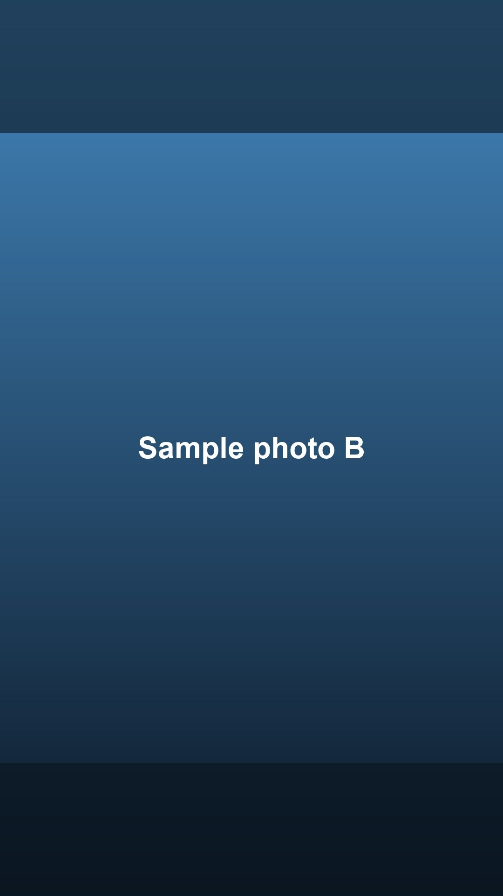

# Instagram photo poster

Finds the photos on your Mac worth posting, helps you write the caption, and publishes them to Instagram only after you approve each one.

I built it with Claude Code to run my own Instagram account. It has published 5 carousel posts to a live account through Instagram's official API.

## The problem

A phone holds thousands of photos, but the good ones get lost. Most of them are screenshots, receipts, blurry frames, ten copies of the same moment, and images other people sent you. Finding the few worth posting takes longer than posting them, so nothing gets posted.

Fully automatic posting is the wrong fix. A caption written by software that doesn't know who is in the picture reads like a stranger wrote it. A picture someone texted you should never go out under your name.

## What it does

1. **Scan.** Reads your Apple Photos library and throws out what is never a post: screenshots, receipts and documents, videos, hidden photos, unpicked burst frames, shots Apple marks as failures, and anything not taken on your camera (ChatGPT images, photos saved from Messages or Messenger).
2. **Rank.** Scores what's left using the 27 quality scores Apple already computes on your Mac for every photo (framing, focus, timing, lighting, and so on). It adds points for people, favorites, and a known location.
3. **Collapse and spread.** Ten shots of one handshake become one candidate. A cap on picks per day and per place keeps one good evening from taking the whole list.
4. **Skip repeats.** Compares candidates against what's already on the account, so the same good photo doesn't keep coming back.
5. **Brief you.** For each pick, it lists what it knows (place, objects, how many shots of that moment) and what it needs from you (who's in it, what happened).
6. **You write and approve the caption.** Approved captions go into a queue.
7. **Publish.** Posts a single photo, a carousel of up to 10, or stories, with tags placed on the photo the people are actually in.

It also renews the Instagram access token before it expires, and it reports new comments on recent posts so you can answer them.

## Sample output

Run on the sample library in `examples/` (14 made-up photo records, 4 placeholder images):

```
$ .venv/bin/python scan.py --library-json examples/sample-library.json --top 5
Found 14 photos in range.

Filtered out:
      1  junk content (paper, receipt)
      1  screenshot
      1  not your photo (saved from ChatGPT)
      1  not your photo (saved from Messages)
      1  not a photo
      1  Apple flagged as a bad shot
      1  trashed/hidden
      1  unselected burst frame

6 photos survived the filter.
4 remain after collapsing duplicate moments.

Staged 4 finalists in candidates/
Manifest: candidates.json

  # 1 score  10.65  2026-09-05  1440x1080  Lakeside Park                    no people
  # 2 score   8.35  2026-09-12  1080x1350  Community Center                 6 unnamed face(s)
  # 3 score   7.45  2026-09-26  800x600   Downtown Market                  2 unnamed face(s)  LOW-RES
  # 4 score   7.40  2026-09-19  1440x1080  River Trail                      no people
```

The ChatGPT image in the sample has the highest quality score of all 14, at 13.5. It is still dropped, because it wasn't taken on your camera. On my real library, an AI-generated image ranked first before this filter existed.

The caption brief for pick #2:

```
$ .venv/bin/python caption.py brief 2
====================================================================
CANDIDATE #2   score 8.35
====================================================================
file        .../candidates/02_0000-gro.jpeg
taken       2026-09-12 10:15
size        1080x1350

WHAT'S KNOWN
  - location: Community Center
  - objects detected: people, crowd
  - one of 3 shots from this moment

WHAT I'D NEED FROM YOU
  - who the 6 people in this photo are
  - what happened - the one detail that makes it worth posting
```

Stories are built as a 9:16 frame: the photo sits whole on a blurred, darkened copy of itself, the way the Instagram app does it.



## Guardrails

- **Nothing posts without you.** The scan only stages files on your Mac. `story.py` only builds previews until you add `--publish`. `post.py --stage` makes Instagram check every photo, the caption, and each tagged username, then stops without publishing.
- **Only your own photos.** Images saved from other apps are filtered out by where they came from, not by how they look.
- **No public copies left behind.** Instagram has to download each photo from a web link. Each photo goes to a private Cloudflare R2 bucket behind a signed link that expires in 15 minutes, and it is deleted once Instagram has it. That happens even if the post fails or you stop it partway.
- **Secrets stay off screen.** `setcreds.py` writes keys into `.env` without showing them on screen, in shell history, or in a chat transcript. `.env` is never committed.
- **Photos post upright.** iPhone photos are often stored sideways with a flag saying "rotate me", and Instagram doesn't always honor it. The rotation is baked into the pixels before upload.
- **Official API only.** No browser automation, which can get an account locked.

## Setup

You need a Mac with Apple Photos, Python 3, an Instagram **Professional** account (Business or Creator, free to switch in the app), and a free Cloudflare account.

1. **Install.**
   ```bash
   python3 -m venv .venv
   .venv/bin/pip install -r requirements.txt
   ```
2. **Try it on the sample data first.** No accounts needed.
   ```bash
   .venv/bin/python scan.py --library-json examples/sample-library.json --top 5
   .venv/bin/python caption.py brief 1
   ```
3. **Scan your own library.** If it can't read Photos, give your terminal access in System Settings > Privacy & Security.
   ```bash
   .venv/bin/python scan.py --days 30 --top 12
   ```
4. **Connect Instagram.** In the Meta developer dashboard, create an app, add the Instagram use case, add your account as a tester, and generate a token. Then:
   ```bash
   cp .env.example .env
   python3 setcreds.py IG_ACCESS_TOKEN --clipboard
   python3 setcreds.py IG_USER_ID
   .venv/bin/python post.py --check
   ```
5. **Make an R2 bucket.** In Cloudflare, create a private R2 bucket and an API token with Object Read & Write on it. Save `R2_ACCOUNT_ID`, `R2_ACCESS_KEY_ID`, `R2_SECRET_ACCESS_KEY`, and `R2_BUCKET` with `setcreds.py`.
6. **Post.**
   ```bash
   .venv/bin/python caption.py save 1 --text "Your caption"
   .venv/bin/python post.py candidates/01_xxxx.jpeg --caption "Your caption" --stage   # check only
   .venv/bin/python post.py candidates/01_xxxx.jpeg --caption "Your caption"           # publish
   ```
7. **Keep the token alive.** Instagram tokens last 60 days and stop working without warning. Schedule `refresh.py` to run daily. It renews the token when 20 days are left and does nothing otherwise.

**If a network call fails:** turn off your VPN first. ProtonVPN's DNS doesn't resolve `graph.instagram.com`, even while instagram.com works fine.

## Files

| File | What it does |
|---|---|
| `scan.py` | Filters and ranks the Photos library, stages the finalists |
| `caption.py` | Briefs you on each pick, stores approved captions |
| `post.py` | Publishes a photo or carousel, with tags |
| `story.py` | Builds story frames and publishes them |
| `r2.py` | Temporary signed links Instagram can download from |
| `refresh.py` | Renews the access token before it expires |
| `comments.py` | Reports new comments on recent posts |
| `seen.py` | Spots photos already on the account |
| `setcreds.py` | Saves keys without showing them |
| `stats.py` | Likes and comments on the latest post |

## Tests

```bash
.venv/bin/python -m unittest -v
```

14 tests cover the filter, ranking, duplicate detection, photo rotation, and the story frame.

## Built with

Python, [osxphotos](https://github.com/RhetTbull/osxphotos), Pillow, the Instagram Content Publishing API, and Cloudflare R2. Designed and built with [Claude Code](https://claude.com/claude-code).
